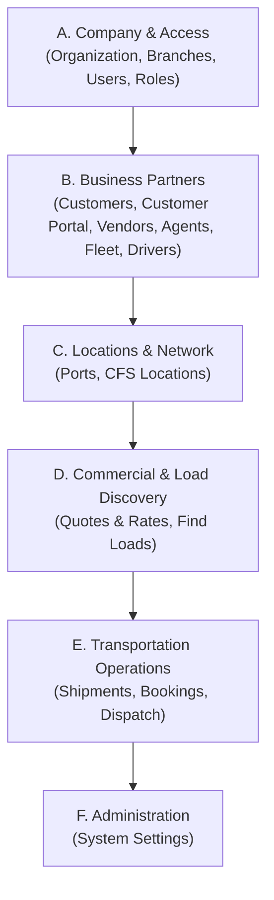

# FMS Frontend — Real-World Sidebar Workflow Optimization: Implementation Report

**Project:** Harbor AI Freight Management System (FMS)  
**Frontend Directory:** `D:\Harbor_AI_Freight_Prototype_Source`  
**Backend Directory:** `D:\freight_backend`  
**Date:** October 13, 2026  
**Status:** **COMPLETE & VERIFIED**

---

## 1. Executive Summary & Objective

The existing FMS sidebar navigation has been reorganized into a logical, real-world freight business workflow. The new organization mirrors the actual operational sequence of an enterprise Freight Management System (TMS/FMS), allowing authorized users across different roles (Shippers, Carriers, Drivers, Dispatchers, Brokers, Finance, and Administrators) to intuitively understand where to start, what to do next, and where each operational tool resides.

### Key Tenets Maintained:
- **Zero Redesign / Harbor AI Fidelity:** Preserved all existing sidebar dimensions, responsive styles, colors, typography, icons, active `.selected` states, collapsed mode (`.sidebar-collapsed`), tooltips, and real data count badges.
- **Route & Workflow Integrity:** Preserved all 18 existing routes, direct URL access, `popstate` navigation history, browser refresh, organization switching, and route guards (`isModulePermitted`).
- **Role-Adaptive Authorization:** Dynamic visibility driven by real RBAC permissions (`hasPermission`), ensuring users only see the groups and modules they are authorized to access without hardcoded counts or security bypasses.
- **Backend Safety:** **Zero modifications** to `D:\freight_backend`.

---

## 2. Existing Sidebar Architecture & Audit Findings

### 2.1 The Legacy Grouping
Prior to this optimization, the sidebar arranged modules into five arbitrary buckets:
```text
People: Users, Roles & Permissions
Business: Organization, Customers, Customer Portal, Vendors, Branches, Agents
Locations: Ports, CFS Locations
Transportation: Shipments, Bookings, Dispatch, Drivers, Find Loads, Quotes & Rates, Carriers & Fleet
Administration: Settings
```

### 2.2 Operational Deficiencies in Legacy Structure:
1. **Fragmented Corporate Setup:** `Branches` was grouped under `Business`, separated from `Organization`, while `Users` and `Roles` were in a separate `People` bucket. In a freight enterprise, Organization and Branches constitute the corporate legal structure, while Users and Roles constitute internal access control.
2. **Conflation of Master Assets with Daily Execution:** `Carriers & Fleet` and `Drivers` were mixed into `Transportation` alongside active execution boards (`Dispatch`, `Shipments`). Fleet assets and qualified drivers are partner/resource directories, not execution events.
3. **Inverted Commercial Sequence:** `Quotes & Rates` and `Find Loads` were placed at the end of `Transportation`, after `Shipments`, `Bookings`, and `Dispatch`. In actual freight logistics, quoting and load discovery happen *before* booking confirmations and dispatch.
4. **Customer Portal Distinction:** `Customer Portal` is a customer-facing workspace (self-service quoting, tracking, documents, invoices) rather than a simple customer-master account registry. Its access needed to remain role-appropriate: serving as the primary operational workspace for Shippers while remaining accessible to authorized internal customer service representatives.

---

## 3. The Real-World Sidebar Hierarchy & Business Rationale

The sidebar now follows the sequential lifecycle of freight operations:



### Group A: Company & Access
- **Purpose:** Foundation & Corporate Governance.
- **Modules:**
  1. **Organization** (`/organization`): Company profile, USDOT/MC credentials, and legal compliance.
  2. **Branches** (`/branches`): Operational hubs, regional offices, and station codes.
  3. **Users** (`/users`): Internal personnel accounts and status.
  4. **Roles & Permissions** (`/roles`): Role master and granular RBAC capability matrix.
- **Business Rationale:** Setting up company entities and assigning access control is the first step before onboarding partners or handling cargo.

### Group B: Business Partners
- **Purpose:** Directory of external relationships and resource masters.
- **Modules:**
  1. **Customers** (`/customers`): Shipper accounts master directory and credit limits.
  2. **Customer Portal** (`/portal`): Shipper self-service quoting, booking, live tracking, documents, and billing workspace.
  3. **Vendors** (`/vendors`): Motor carriers, drayage providers, and freight service vendors.
  4. **Agents** (`/agents`): Freight brokers, forwarders, and sales agents.
  5. **Carriers & Fleet** (`/fleet`): Carrier qualification, tractor/trailer assets, and HOS logs.
  6. **Drivers** (`/drivers`): Driver roster, qualifications, CDL licenses, and medical compliance.
- **Business Rationale:** Centralizes all external counterparties and physical assets required to quote or move freight.

### Group C: Locations & Network
- **Purpose:** Physical transport infrastructure and routing hubs.
- **Modules:**
  1. **Ports** (`/ports`): Commercial seaports, inland terminals, and intermodal transport hubs.
  2. **CFS Locations** (`/cfs`): Container Freight Stations, inland container depots, and bonded deconsolidation facilities.
- **Business Rationale:** Transport orders and routes originate or terminate at these physical facilities.

### Group D: Commercial & Load Discovery
- **Purpose:** Freight demand, pricing, and matching.
- **Modules:**
  1. **Quotes & Rates** (`/quotes`): Spot quoting, committed contract agreements, LTL tariffs, and multi-carrier comparisons.
  2. **Find Loads** (`/load-board`): Freight matching, posting public/private loads, and live carrier bidding.
- **Business Rationale:** Revenue generation occurs here. Quotes and load matches feed directly into confirmed bookings.

### Group E: Transportation Operations
- **Purpose:** Active execution lifecycle.
- **Modules:**
  1. **Shipments** (`/shipments`): Operational overview of all freight movements across life cycle states.
  2. **Bookings** (`/bookings`): Booking requests, rate confirmation generation, and electronic signatures.
  3. **Dispatch** (`/dispatch`): Dispatch board, fleet assignment, route optimization (TSP-TW), driver turn-by-turn routing, live check-calls, milestones, and dynamic ETA tracking.
- **Business Rationale:** Represents the operational progression: Shipment ➔ Rate Confirmation / Booking ➔ Dispatch & Milestone Tracking.

### Group F: Administration
- **Purpose:** System-wide governance and audit.
- **Modules:**
  1. **Settings** (`/admin`): Central registry for statuses, category overrides, and audit logs.
- **Business Rationale:** Global platform configuration positioned at the bottom of the navigation.

---

## 4. Role-by-Role Navigation & Access Behavior

The sidebar evaluates `hasPermission` dynamically. If a role lacks permission for every module in a group, that entire section heading and group container are hidden.

| Role | Landing Page | Visible Sidebar Groups | Permitted Modules | Hidden / Restricted Modules |
|---|---|---|---|---|
| **Shipper User** | `/portal` | Business Partners, Locations, Commercial, Administration | Customer Portal, Ports, CFS Locations, Quotes & Rates, Find Loads, Settings (read) | Company & Access (all), Vendors, Agents, Fleet, Drivers, Dispatch |
| **Carrier Admin** | `/load-board` | Company & Access, Business Partners, Locations, Commercial, Operations, Administration | Organization, Branches, Users, Roles, Carriers & Fleet, Drivers, Ports, CFS, Find Loads, Quotes & Rates, Shipments, Bookings, Dispatch, Settings | Customers, Vendors, Agents |
| **Driver** | `/dispatch` | Business Partners, Operations | Carriers & Fleet (read assigned), Drivers (own profile), Dispatch (assigned runs, check-calls, milestones) | Company & Access (all), Customers, Vendors, Agents, Ports, CFS, Quotes, Find Loads, Bookings, Settings |
| **Dispatcher** | `/dispatch` | Business Partners, Locations, Commercial, Operations, Administration | Customers, Vendors, Agents, Fleet, Drivers, Ports, CFS, Quotes & Rates, Find Loads, Shipments, Bookings, Dispatch, Settings | Company & Access (Users, Roles) |
| **Broker / Ops** | `/shipments` | Company & Access, Business Partners, Locations, Commercial, Operations, Administration | Branches, Organization, Customers, Vendors, Agents, Fleet, Drivers, Ports, CFS, Quotes & Rates, Find Loads, Shipments, Bookings, Dispatch, Settings | Users & Roles (if not admin) |
| **Finance** | `/bookings` | Business Partners, Locations, Commercial, Operations, Administration | Customers, Vendors, Ports, CFS, Quotes & Rates (audit), Bookings (invoicing & rate confirmations), Shipments, Settings | Company & Access (all), Dispatch, Drivers |
| **Platform / Company Admin** | `/shipments` | All 6 Groups | All 18 Modules across Company, Partners, Locations, Commercial, Operations, and Administration | None |

### Dynamic Features Preserved:
1. **Multi-Role Permission Union:** If a user holds multiple roles across organizations, `permissionSet` merges capabilities without duplicating sidebar entries.
2. **Organization Switching:** Switching active organization recalculates all permission booleans immediately, re-rendering visible groups without a hard page reload.
3. **Direct URL Guard:** Direct navigation to a restricted route triggers `isModulePermitted(modId)` and displays the access-denied screen with a one-click button returning to their permitted landing page.

---

## 5. Technical Preservation & Verification Matrix

### 5.1 Route Mapping Table
All 18 operational routes remained unchanged:

| Module Key | Route URL | Page Component | Data / Count Badge Source |
|---|---|---|---|
| `organization` | `/organization` | `OrganizationView` | `records.organization?.length` |
| `branches` | `/branches` | `BranchMaster` | `records.branches?.length` |
| `users` | `/users` | `UserManagement` | `records.users?.length` |
| `roles` | `/roles` | `RolePermissionMaster` | `records.roles?.length` |
| `customers` | `/customers` | `CustomerMaster` | Real Customer API / search |
| `portal` | `/portal` | `CustomerPortal` | Real Shipper Orders API |
| `vendors` | `/vendors` | `VendorMaster` | Real Vendors API / search |
| `agents` | `/agents` | `AgentMaster` | Real Agents API / search |
| `fleet` | `/fleet` | `CarrierFleetManagement` | `records.fleet?.length` |
| `drivers` | `/drivers` | `DriverMaster` | Real Driver Profiles API |
| `ports` | `/ports` | `PortMaster` | Real Ports API / search |
| `cfs` | `/cfs` | `CfsMaster` | Real CFS API / search |
| `quotes` | `/quotes` | `QuoteRateManagement` | `records.quotes?.length` |
| `load_board` | `/load-board` | `LoadBoard` | `records.load_board?.length` |
| `shipments` | `/shipments` | `BookingManagement` (Shipment view) | `records.shipments?.length` |
| `bookings` | `/bookings` | `BookingManagement` (Booking view) | `records.bookings?.length` |
| `dispatch` | `/dispatch` | `DispatchManagement` | Real Dispatch board API |
| `admin` | `/admin` | `SettingsRegistry` | `records.admin?.length` |

---

## 6. Files Changed

| File | Status | Description of Change |
|---|---|---|
| `src/App.jsx` | **Modified** | Reorganized `ModuleNavigation` into the 6 approved business workflow groups (Company & Access, Business Partners, Locations & Network, Commercial & Load Discovery, Transportation Operations, Administration). Updated group permission booleans (`canReadCompanyAndAccess`, `canReadBusinessPartners`, `canReadLocationsAndNetwork`, `canReadCommercial`, `canReadOperations`), enhanced tooltips, and tuned `handleManageClick` default route resolution. |
| `FMS_Sidebar_Workflow_Implementation_Report.md` | **Created** | Comprehensive implementation and verification report. |

---

## 7. Build & Test Verification

### 7.1 Sites Packaging Tests
```bash
npm run test:sites
# ✔ serves existing static assets without a fallback (700.624ms)
# ✔ falls back to index.html for an unknown app route (13.9339ms)
# ✔ does not turn missing API or write requests into the app shell (46.8193ms)
# ✔ emits the files required by Sites packaging (182.1819ms)
# ℹ tests 4, suites 0, pass 4, fail 0
```

### 7.2 Production Build
```bash
npm run build
# vite v6.4.2 building for production...
# ✓ 4647 modules transformed.
# dist/client/index.html                     0.57 kB
# dist/client/assets/index-BkYokU57.css    273.53 kB
# dist/client/assets/index-DtE2j0ZL.js   1,570.31 kB
# Prepared Sites build: dist/server/index.js and dist/.openai/hosting.json
```

### 7.3 Backend Integrity
- Repository `D:\freight_backend` remains **100% unaltered**. Zero commits, edits, or deletions.

---

## 8. Summary of Completion

The FMS frontend sidebar now reflects an authentic, intuitive freight management workflow:
1. **Foundation & Governance First:** Corporate entity and internal access are established in **Company & Access**.
2. **Ecosystem Masters Second:** Partners, customer portal, vendors, fleet, and drivers are grouped in **Business Partners**.
3. **Physical Hubs Third:** Global infrastructure is organized in **Locations & Network**.
4. **Commercial Phase Fourth:** Demand, spot quoting, and load board discovery are organized in **Commercial & Load Discovery**.
5. **Operational Execution Fifth:** Transport requests, bookings, and fleet execution live in **Transportation Operations**.
6. **Governance Sixth:** Global administration is accessible in **Administration**.
